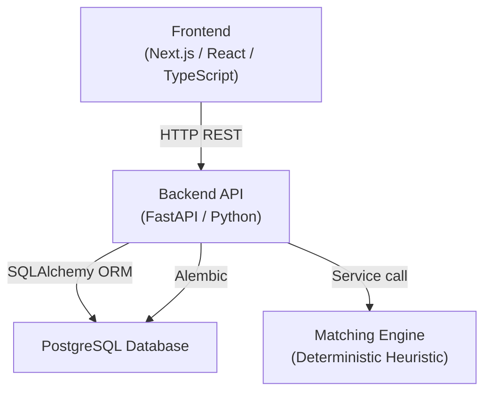

<h1 align="center">BharatMaterials</h1>
<p align="center"><strong>National Material Intelligence Platform</strong></p>
<p align="center"><em>"One Nation. One Material. One Source of Truth."</em></p>
<p align="center">
  <a href="https://github.com/TasisAlwaz/SIH-26099">github.com/TasisAlwaz/SIH-26099</a>
</p>

---

## Table of Contents

- [Project Overview](#project-overview)
- [Key Features](#key-features)
- [Relationship Categories](#relationship-categories)
- [Prototype Status and Limitations](#prototype-status-and-limitations)
- [Architecture](#architecture)
- [Technology Stack](#technology-stack)
- [Prerequisites](#prerequisites)
- [Getting Started](#getting-started)
  - [Clone the Repository](#1-clone-the-repository)
  - [Environment Configuration](#2-environment-configuration)
  - [Database Setup](#3-database-setup)
  - [Run the Backend](#4-run-the-backend)
  - [Run the Frontend](#5-run-the-frontend)
- [Complete Local Startup Guide](#complete-local-startup-guide)
- [Troubleshooting](#troubleshooting)
- [Development and Testing](#development-and-testing)
- [Repository Structure](#repository-structure)
- [Roadmap and Future Scope](#roadmap-and-future-scope)
- [Contributing](#contributing)
- [Security](#security)
- [License](#license)

---

## Project Overview

### The Problem

Central Public Sector Enterprises (CPSEs) across India each maintain independent material master databases. Because every enterprise uses its own codes, naming conventions, and classification schemas:

- **The same physical material** (e.g., an SS304 ball valve, DN50, 150#) can appear under completely different catalog descriptions and item codes across multiple CPSEs.
- **Cross-enterprise identification is difficult** — there is no unified way to discover that two enterprises are purchasing the same item.
- **Duplicate and near-duplicate records** fragment inventory visibility and complicate procurement analysis at the national level.

### The Proposed Solution

**BharatMaterials** is a material intelligence and harmonization platform designed to:

1. **Standardize material descriptions and attributes** — normalize catalog records from participating CPSEs into a structured, comparable format.
2. **Compare candidate material pairs** — evaluate multi-attribute similarity across descriptions, specifications, units of measure, material grades, sizes, ratings, and manufacturers.
3. **Classify relationships with explainable recommendations** — assign a relationship category (IDENTICAL, DUPLICATE, NEAR_DUPLICATE, FUNCTIONALLY_EQUIVALENT, or NOT_EQUIVALENT) with a confidence score and a structured breakdown of contributing signals.
4. **Support human-in-the-loop governance** — every recommendation enters an approval queue where authorized procurement officers can approve, reject, or modify the classification before it takes effect.
5. **Assign a National Material Code (NMC)** — approved material clusters receive a standardized code that serves as a common reference across all participating enterprises.
6. **Preserve original enterprise codes and auditability** — CPSE legacy material codes are never deleted or overwritten. Bidirectional traceability is maintained between enterprise codes and national codes.

> **Important:** NMC assignment is governed by application logic and authorized human review — it is never automatically guaranteed by a model prediction alone.

---

## Key Features

| Feature | Description | Status |
|---|---|---|
| **Dashboard** | Aggregated metrics, relationship distribution chart, recent match recommendations, and procurement harmonization value indicators | Functional prototype (illustrative data) |
| **Material Explorer** | Browse, search, and inspect individual material records with full attribute detail | Functional prototype |
| **Material Matching** | Select two materials, run a multi-signal heuristic comparison, and view explainable similarity breakdowns | Functional prototype |
| **Approval Queue** | Human-in-the-loop workflow — approve, reject, or modify relationship recommendations with officer notes and audit logging | Functional prototype |
| **National Materials** | Browse the national material master with linked enterprise source codes | Functional prototype |
| **CPSE Management** | View participating enterprises, their material counts, sectors, and status | Functional prototype |
| **Data Upload** | Upload material catalog data for ingestion | UI implemented |
| **Analytics** | Procurement and material analytics dashboards | Functional prototype (illustrative data) |
| **Audit Trail** | Immutable audit log of all system actions, match analyses, and approval decisions | Functional prototype |
| **Settings** | Platform configuration, matching engine status, and user role display | Functional prototype |

---

## Relationship Categories

The matching engine classifies each material pair into one of five relationship categories:

| Category | Description |
|---|---|
| **IDENTICAL** | The two records describe the exact same material item — descriptions, specifications, grade, size, UOM, and manufacturer all align closely. |
| **DUPLICATE** | The records describe the same material with minor catalog phrasing or formatting differences — functionally identical items. |
| **NEAR_DUPLICATE** | Highly similar materials with small but potentially meaningful differences in specifications, grade, or manufacturer. |
| **FUNCTIONALLY_EQUIVALENT** | Different catalog entries that could serve the same engineering purpose despite terminology or parameter variations. |
| **NOT_EQUIVALENT** | The materials are fundamentally different and should not be consolidated. |

> These categories are **recommendations intended to support human review**. An authorized officer must confirm, modify, or reject each classification before it affects the national material master.

---

## Prototype Status and Limitations

> [!IMPORTANT]
> This section describes the current state of the project honestly.

- **Matching engine:** The current system uses a **deterministic heuristic engine** — not a trained machine-learning model. It computes similarity using token overlap, sequence matching (difflib), UOM equivalence tables, metallurgy grade lookups, and weighted multi-signal formulas. Results are reproducible and explainable, but have not been calibrated or validated against a labeled ground-truth dataset.

- **Simulated data:** The demonstration runs on **simulated CPSE material records** seeded automatically at startup. These are representative examples — they are not actual production data from IOCL, NTPC, SAIL, BHEL, or any other enterprise.

- **Not production-ready:** The platform is a functional prototype developed for the Smart India Hackathon (SIH) Problem Statement 26099. It has not been deployed in production, undergone security hardening, or processed real enterprise material masters at scale.

- **Future ML integration planned:** A real ML inference engine (model architecture, embedding strategy, and training pipeline) will be evaluated and integrated after a labeled dataset is available for training and validation. The codebase includes a `BaseMatchingEngine` abstract class to support swapping the heuristic engine for a trained model without frontend changes.

- **Dashboard values are illustrative:** Metrics such as "procurement harmonization value" or "rationalization savings" are computed from the simulated dataset. They must not be interpreted as verified financial figures or live CPSE statistics.

- **Inventory Cross and inter-CPSE trade:** These are future-scope concepts. The current prototype does not implement cross-enterprise stock discovery or governed inter-CPSE transfers.

---

## Architecture



| Layer | Responsibility |
|---|---|
| **Frontend** | Next.js 14 App Router application — dashboard, material explorer, matching UI, approval queue, analytics, audit log, and settings pages. Communicates exclusively through the backend REST API. |
| **Backend API** | FastAPI application serving versioned REST endpoints under `/api/v1`. Handles CORS, request validation (Pydantic), business logic, matching orchestration, approval workflows, and audit logging. |
| **Database** | PostgreSQL — stores CPSEs, materials, matches, approvals, national materials, mappings, audit logs, and uploads. Schema managed through Alembic migrations. |
| **Matching Engine** | Pluggable engine behind an abstract `BaseMatchingEngine` interface. The current `MockMatchingEngine` uses deterministic heuristics. A future ML engine can be swapped in by setting `AI_MODE=real` in the backend environment (not yet implemented). |

---

## Technology Stack

All technologies listed below are verified from the repository dependency manifests.

### Frontend

| Technology | Version | Purpose |
|---|---|---|
| [Next.js](https://nextjs.org/) | 14.2.24 | React framework (App Router) |
| [React](https://react.dev/) | 18.3.1 | UI component library |
| [TypeScript](https://www.typescriptlang.org/) | ^5.7.2 | Type-safe JavaScript |
| [Tailwind CSS](https://tailwindcss.com/) | ^3.4.16 | Utility-first CSS framework |
| [Recharts](https://recharts.org/) | 2.13.0 | Charting library for analytics |
| [React Flow](https://reactflow.dev/) | 11.11.4 | Material relationship graph visualization |
| [Lucide React](https://lucide.dev/) | ^0.460.0 | Icon library |

### Backend

| Technology | Version | Purpose |
|---|---|---|
| [Python](https://www.python.org/) | 3.12+ | Backend runtime |
| [FastAPI](https://fastapi.tiangolo.com/) | 0.115.6 | Async REST API framework |
| [Pydantic](https://docs.pydantic.dev/) | 2.10.4 | Data validation and schemas |
| [pydantic-settings](https://docs.pydantic.dev/latest/concepts/pydantic_settings/) | 2.7.0 | Environment-based configuration |
| [SQLAlchemy](https://www.sqlalchemy.org/) | 2.0.36 | ORM and database toolkit |
| [Alembic](https://alembic.sqlalchemy.org/) | 1.14.0 | Database schema migrations |
| [psycopg 3](https://www.psycopg.org/psycopg3/) | 3.2.4 | PostgreSQL adapter |
| [Uvicorn](https://www.uvicorn.org/) | 0.34.0 | ASGI server |
| [HTTPX](https://www.python-httpx.org/) | 0.28.1 | HTTP client (testing) |
| [pytest](https://docs.pytest.org/) | 8.3.4 | Test framework |

### Infrastructure

| Technology | Purpose |
|---|---|
| PostgreSQL 16 | Relational database |
| Docker Compose | Optional PostgreSQL containerization |

---

## Prerequisites

Before running BharatMaterials locally, ensure you have:

| Requirement | Minimum | Notes |
|---|---|---|
| **Git** | 2.x | For cloning the repository |
| **Python** | 3.12+ | Backend uses `psycopg[binary]` 3.x and `type` union syntax (`str \| None`) |
| **Node.js** | 18+ or 20+ LTS | Required for Next.js 14 |
| **npm** | 10+ | Installed with Node.js |
| **PostgreSQL** | 14+ | Can be installed natively or via Docker Compose |
| **Docker & Docker Compose** | *(Optional)* | Only needed if you want to run PostgreSQL as a container |

---

## Getting Started

### 1. Clone the Repository

```bash
git clone https://github.com/TasisAlwaz/SIH-26099.git
cd SIH-26099
```

The latest BharatMaterials prototype is on the `phase6-refinement` branch. Check it out:

```bash
git switch phase6-refinement
```

Verify you're on the correct branch:

```bash
git log --oneline -3
```

You should see the latest commit: `430a91a Update SIH 26099 application`.

---

### 2. Environment Configuration

#### Backend

```bash
cp backend/.env.example backend/.env
```

Edit `backend/.env` to configure your database connection:

```dotenv
# PostgreSQL Database connection
POSTGRES_USER=postgres
# Use "postgres_dev_password" for default Docker Compose, or your local password for native PostgreSQL
POSTGRES_PASSWORD=postgres_dev_password
POSTGRES_HOST=localhost
POSTGRES_PORT=5432
POSTGRES_DB=nmat_db
```

> **Environment resolution & port note:**
> - **Port alignment:** The backend code (`backend/app/core/config.py`) defaults `POSTGRES_PORT` to `5433` if unset. However, `docker-compose.yml` maps `${POSTGRES_PORT:-5432}:5432` on the host, and native PostgreSQL typically listens on `5432`. Setting `POSTGRES_PORT=5432` in `backend/.env` ensures the backend connects to the database container or local service.
> - **Where variables are read from:** The backend uses `pydantic-settings` configured with `env_file=(".env", "../.env")`. When commands are run from inside `backend/`, `backend/.env` is loaded automatically. If running commands from the repository root, create a root `.env` (`cp .env.example .env`) or run backend commands from `backend/`.

| Variable | Default | Description |
|---|---|---|
| `APP_ENV` | `development` | Application environment (`development` / `production`) |
| `LOG_LEVEL` | `INFO` | Python logging level (`DEBUG`, `INFO`, `WARNING`, `ERROR`) |
| `AI_MODE` | `mock` | Matching engine mode (`mock` is the active deterministic heuristic engine) |
| `API_HOST` | `0.0.0.0` | Backend bind address |
| `API_PORT` | `8000` | Backend port |
| `POSTGRES_USER` | `postgres` | PostgreSQL username |
| `POSTGRES_PASSWORD` | `postgres_dev_password` | PostgreSQL password (matches `docker-compose.yml` default) |
| `POSTGRES_HOST` | `localhost` | PostgreSQL host |
| `POSTGRES_PORT` | `5433` | PostgreSQL port (config.py default; docker-compose exposes `5432` — set explicitly in `.env`) |
| `POSTGRES_DB` | `nmat_db` | PostgreSQL database name |
| `DATABASE_URL` | *(none)* | Optional override — full connection string. If set, overrides individual `POSTGRES_*` fields. |
| `BACKEND_CORS_ORIGINS` | `http://localhost:3000,http://127.0.0.1:3000` | Comma-separated allowed origins |

#### Frontend

```bash
cp frontend/.env.example frontend/.env.local
```

The default value (`http://localhost:8000/api/v1`) works if the backend runs on port 8000:

```dotenv
NEXT_PUBLIC_API_URL=http://localhost:8000/api/v1
```

---

### 3. Database Setup

#### Option A: Docker Compose (recommended for quick setup)

```bash
# From the repository root
docker compose up -d postgres
```

This starts PostgreSQL 16 on port 5432 (or the port configured in `POSTGRES_PORT`). The default credentials match the backend defaults.

Verify it's running:

```bash
docker compose ps
```

#### Option B: Native PostgreSQL

If you have PostgreSQL installed locally:

```bash
# Connect as the postgres superuser and create the database
sudo -u postgres psql -c "CREATE DATABASE nmat_db;"
```

If your local PostgreSQL user/password differs from the defaults, update `backend/.env` accordingly.

#### Apply Migrations

After the database is running:

```bash
cd backend
python3 -m venv .venv
source .venv/bin/activate
pip install -r requirements.txt

# Run Alembic migrations
alembic upgrade head
```

This creates the required tables: `cpses`, `materials`, `matches`, `approvals`, `audit_logs`, `national_materials`, `material_mappings`, and `uploads`.

#### Seed Simulated Data (Recommended)

The repository includes a dedicated ingestion script that seeds PostgreSQL with representative simulated CPSE material data from `data/raw/cpse_material_master_synthetic.csv`.

With the backend virtual environment activated, run:

```bash
# From the backend directory:
python3 ../scripts/import_material_master.py

# Or from the repository root:
python3 scripts/import_material_master.py
```

To clean existing records and re-seed from scratch:

```bash
python3 ../scripts/import_material_master.py --force
```

This populates:
- **4 CPSE organizations:** IOCL, NTPC, SAIL, BHEL
- **1,340 unique National Materials** (`NMC-100001` through `NMC-101340`)
- **9,600 CPSE legacy materials** with technical attributes (specifications, UOM, grades, manufacturers)
- **9,600 bidirectional material mappings**
- **Catalog batch upload history**
- **15 representative candidate matches** across all 5 relationship classes with explainability breakdown scores
- **9 officer approvals** in the review queue
- **Audit log events** for system initialization and harmonization

> **Rerun behavior & limitations:**
> - **Idempotent by default:** If run without `--force` on an already-seeded database, the script detects existing records and safely exits without creating duplicates or modifying existing data.
> - **Force reset limitation:** Using `--force` performs a cascading deletion across all application tables before re-importing. Any officer decisions made in the approval queue, interactive match analyses, or new catalog uploads created during runtime will be permanently cleared.
> - **Test suite requirement:** The backend test suite (`tests/test_db.py`) asserts against these seeded record counts. Running the seed script is required for `test_seeded_database_counts` to pass.

---

### 4. Run the Backend

```bash
cd backend
source .venv/bin/activate
uvicorn app.main:app --reload --host 0.0.0.0 --port 8000
```

Once started:

| Resource | URL |
|---|---|
| API root | http://localhost:8000 |
| Swagger / OpenAPI docs | http://localhost:8000/api/v1/docs |
| ReDoc | http://localhost:8000/api/v1/redoc |
| Health check | http://localhost:8000/api/v1/health |

---

### 5. Run the Frontend

In a **separate terminal**:

```bash
cd frontend
npm install
npm run dev
```

Open your browser at:

> **http://localhost:3000**

The root page (`/`) redirects to the Dashboard (`/dashboard`).

> The frontend requires the backend and database to be running for API calls to succeed. Without the backend, API-dependent pages will show connection errors.

---

## Complete Local Startup Guide

A step-by-step summary for new developers:

```
Terminal 1 (Database + Backend)          Terminal 2 (Frontend)
──────────────────────────────           ─────────────────────

# 1. Clone and checkout
git clone https://github.com/TasisAlwaz/SIH-26099.git
cd SIH-26099
git switch phase6-refinement

# 2. Start PostgreSQL (Docker)
docker compose up -d postgres

# 3. Configure backend
cp backend/.env.example backend/.env
# Edit backend/.env with your DB credentials

# 4. Install backend + migrate
cd backend
python3 -m venv .venv
source .venv/bin/activate
pip install -r requirements.txt
alembic upgrade head

# 5. Seed simulated dataset (recommended)
python3 ../scripts/import_material_master.py

# 6. Start backend
uvicorn app.main:app --reload
                                         # 7. Configure frontend
                                         cd frontend
                                         cp .env.example .env.local
                                         # Edit .env.local if needed

                                         # 8. Install frontend + start
                                         npm install
                                         npm run dev

# 9. Open browser: http://localhost:3000
# 10. Verify API: http://localhost:8000/api/v1/health
```

---

## Troubleshooting

### Port 3000 already in use

```bash
# Find the process using port 3000
lsof -i :3000
# Then stop it gracefully, or run Next.js on a different port:
npm run dev -- -p 3001
```

### Port 8000 already in use

```bash
lsof -i :8000
# Run backend on a different port:
uvicorn app.main:app --reload --port 8001
# Update frontend/.env.local to match:
# NEXT_PUBLIC_API_URL=http://localhost:8001/api/v1
```

### PostgreSQL connection refused

- Verify PostgreSQL is running: `docker compose ps` or `systemctl status postgresql`
- Check that `POSTGRES_HOST`, `POSTGRES_PORT`, and credentials in `backend/.env` match your setup
- If using Docker Compose, ensure the container is healthy: `docker compose logs postgres`
- If using native PostgreSQL on a non-default port, update `POSTGRES_PORT` in `backend/.env`

### Missing environment variables

The backend uses `pydantic-settings` with defaults for all variables. If you see configuration errors, ensure `backend/.env` exists and is properly formatted.

### CORS errors in browser console

- Verify `BACKEND_CORS_ORIGINS` in `backend/.env` includes your frontend URL (e.g., `http://localhost:3000`)
- If running the frontend on a different port, add that origin to the list

### Frontend cannot reach the backend

- Confirm the backend is running and accessible at the URL in `frontend/.env.local`
- Check that `NEXT_PUBLIC_API_URL` includes the `/api/v1` path prefix
- Verify no firewall or proxy is blocking localhost connections

### Database migration errors

```bash
# Check current migration state
cd backend
source .venv/bin/activate
alembic current

# If the database is in an inconsistent state, you can stamp and retry:
alembic stamp head
alembic upgrade head
```

### Dependencies not installed

```bash
# Backend
cd backend && source .venv/bin/activate && pip install -r requirements.txt

# Frontend
cd frontend && npm install
```

---

## Development and Testing

### Frontend

```bash
cd frontend

# Development server
npm run dev

# Production build
npm run build

# Lint
npm run lint
```

### Backend

```bash
cd backend
source .venv/bin/activate

# Run tests (requires PostgreSQL to be running)
pytest

# Run tests with verbose output
pytest -v

# Run a specific test file
pytest tests/test_health.py -v
```

Test files:
- `tests/test_health.py` — Root endpoint and health check
- `tests/test_config.py` — Configuration loading
- `tests/test_db.py` — Database connectivity
- `tests/test_api_v1.py` — API endpoint tests

> **Note:** Tests require a running PostgreSQL instance with the correct credentials configured in `backend/.env`.

---

## Repository Structure

```
SIH-26099/
├── backend/
│   ├── alembic/                    # Database migration scripts
│   │   ├── env.py                  # Alembic environment (reads app config)
│   │   └── versions/               # Migration revisions
│   ├── app/
│   │   ├── api/v1/
│   │   │   ├── api.py              # Router aggregator
│   │   │   └── endpoints/          # Route handlers
│   │   │       ├── analytics.py
│   │   │       ├── approvals.py
│   │   │       ├── audit.py
│   │   │       ├── auth.py
│   │   │       ├── cpses.py
│   │   │       ├── health.py
│   │   │       ├── mappings.py
│   │   │       ├── matches.py
│   │   │       ├── materials.py
│   │   │       ├── national_materials.py
│   │   │       └── uploads.py
│   │   ├── core/
│   │   │   └── config.py           # Pydantic Settings (env vars)
│   │   ├── db/
│   │   │   ├── base.py             # Model imports for Alembic
│   │   │   ├── base_class.py       # SQLAlchemy declarative base
│   │   │   └── session.py          # Engine and session factory
│   │   ├── models/                 # SQLAlchemy ORM models
│   │   ├── schemas/                # Pydantic request/response schemas
│   │   ├── services/               # Business logic
│   │   │   ├── matching_engine.py  # Heuristic matching engine
│   │   │   ├── matching_service.py # Match orchestration
│   │   │   └── ...
│   │   └── main.py                 # FastAPI application entry point
│   ├── tests/                      # pytest test suite
│   ├── alembic.ini                 # Alembic configuration
│   ├── requirements.txt            # Python dependencies
│   └── .env.example                # Backend environment template
├── frontend/
│   ├── src/
│   │   ├── app/                    # Next.js App Router pages
│   │   │   ├── dashboard/
│   │   │   ├── materials/
│   │   │   ├── matches/
│   │   │   ├── approvals/
│   │   │   ├── national-materials/
│   │   │   ├── cpses/
│   │   │   ├── analytics/
│   │   │   ├── audit/
│   │   │   ├── upload/
│   │   │   ├── settings/
│   │   │   ├── layout.tsx          # Root layout
│   │   │   └── page.tsx            # Root redirect → /dashboard
│   │   ├── components/             # Reusable UI components
│   │   │   ├── layout/             # Sidebar, TopBar, AppLayout
│   │   │   └── ui/                 # WatermarkBadge, badges, etc.
│   │   ├── data/mock/              # Client-side mock/fallback data
│   │   ├── lib/api/client.ts       # Centralized API client
│   │   ├── services/               # Frontend service layer
│   │   └── types/                  # TypeScript type definitions
│   ├── package.json
│   ├── next.config.mjs
│   ├── tsconfig.json
│   └── .env.example                # Frontend environment template
├── docker/
│   └── postgres-init/              # PostgreSQL init scripts (placeholder)
├── data/
│   └── raw/
│       └── cpse_material_master_synthetic.csv # Simulated CPSE dataset (9,600 records)
├── docs/                           # Architecture specifications & constitution
├── scripts/
│   └── import_material_master.py   # Database seeding & ingestion script
├── docker-compose.yml              # PostgreSQL container setup
├── .env.example                    # Root environment configuration template
├── .gitignore
├── PROGRESS.md                     # Milestone and phase execution tracker
├── project_context.md              # Authoritative project memory and invariants
└── README.md
```

---

## Roadmap and Future Scope

### Implemented (Current Prototype)

- [x] Full-stack web application (Next.js + FastAPI + PostgreSQL)
- [x] Material explorer with structured attribute display
- [x] Deterministic heuristic matching engine with multi-signal breakdown
- [x] Five-class relationship classification (IDENTICAL → NOT_EQUIVALENT)
- [x] Explainable rationale and detected differences
- [x] Human-in-the-loop approval queue with officer notes
- [x] National Material Code (NMC) recommendation workflow
- [x] Audit trail for all system actions
- [x] Dashboard with metrics and relationship distribution
- [x] CPSE management and analytics views
- [x] Alembic-managed database schema

### Planned (Future Scope)

- [ ] **Dataset-driven ML matching** — train a relationship classification model on labeled CPSE material pairs
- [ ] **Material normalization and attribute extraction** — automated parsing of unstructured catalog descriptions
- [ ] **Confidence calibration** — validate and calibrate confidence scores against ground-truth labels
- [ ] **Explainability improvements** — feature importance, attention visualization, decision boundary analysis
- [ ] **Inventory Cross** — discover available stock of matched materials across participating CPSEs
- [ ] **Governed inter-CPSE transfers** — facilitate material sharing and transfers between enterprises under procurement rules
- [ ] **Demand aggregation** — coordinated procurement across CPSEs for consolidated purchasing
- [ ] **Security hardening** — authentication, authorization, role-based access control
- [ ] **Containerized deployment** — Dockerfiles for backend and frontend, full Docker Compose stack
- [ ] **Performance testing** — load testing, query optimization for large material catalogs

---

## Contributing

Contributions are welcome. To contribute:

1. Fork the repository.
2. Create a feature branch from `phase6-refinement`:
   ```bash
   git switch -c feature/your-feature-name phase6-refinement
   ```
3. Make your changes with clear, descriptive commits.
4. Ensure the backend tests pass (`pytest`) and the frontend builds (`npm run build`).
5. Open a pull request describing what you changed and why.

### Guidelines

- Do not commit `.env` files, API keys, passwords, tokens, or real enterprise data.
- Maintain the existing code structure and conventions.
- Test new backend endpoints with pytest.
- Keep the README accurate — update it if your changes affect setup or configuration.

---

## Security

- **Never commit secrets** — `.env` files, private keys, tokens, and credentials are excluded via `.gitignore`.
- **Do not include real CPSE data** — the repository should only contain simulated demonstration data.
- **Report vulnerabilities** — if you discover a security issue, please open a private issue or contact the repository owner directly.

---

## License

This repository does not currently include an explicit open-source license file. All rights are reserved by the project author unless otherwise specified.

> If you intend to reuse, fork, or redistribute this code, please contact the repository owner to clarify licensing terms. Adding a `LICENSE` file (e.g., MIT, Apache 2.0) is recommended before inviting external contributions.

---

<p align="center">
  <strong>BharatMaterials</strong> — National Material Intelligence Platform<br/>
  Smart India Hackathon · Problem Statement 26099
</p>
