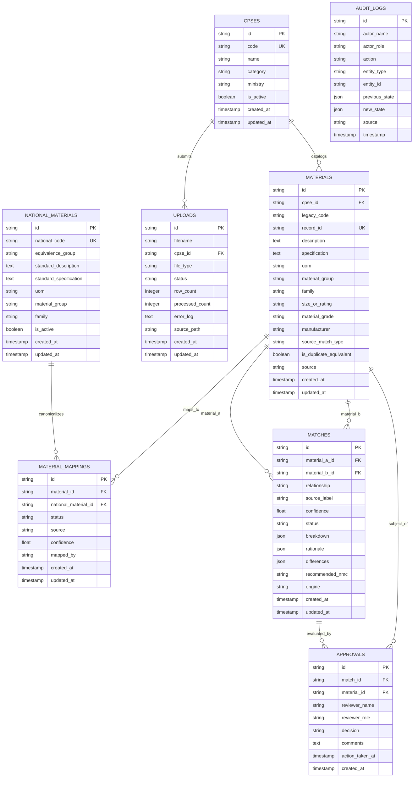

# N-MAT Database Architecture & Data Management Specification

**Document Reference:** `docs/04_DATABASE.md`  
**Problem Statement:** SIH PS 26099 — National Material Intelligence Platform  
**Current Phase:** Phase 4 — Database & Data Management (COMPLETED)  
**Database Engine:** PostgreSQL 16 (Port 5433)  
**ORM & Migrations:** SQLAlchemy 2.0 / Alembic 1.14  
**Current Alembic Head:** `6ac9cb4dad1b` (`create core nmat tables`)  

---

## 1. Executive Summary & Architecture Overview

Phase 4 establishes the authoritative, normalized relational data layer for the N-MAT platform. The data architecture implements bidirectional traceability between CPSE legacy material masters and unified National Material Codes (NMCs) without corrupting, deleting, or altering legacy identifier records.

### Core Architectural Invariants:
1. **Bidirectional Traceability:** Every legacy material code cataloged across Indian CPSEs (`IOCL`, `NTPC`, `SAIL`, `BHEL`) is retained in its raw and normalized form in `materials`, mapped via `material_mappings` to the standardized `national_materials` record.
2. **Deterministic Governance:** AI predictions are recorded in `matches`, but approval decisions reside immutably in `approvals` with human officer signatures.
3. **Immutable Audit Trail:** State transitions and system operations are committed to `audit_logs` with JSON diffs of previous and subsequent states.
4. **Zero ML Dependencies:** Ingestion, database seeding, normalization, and integrity verification are executed using Python standard library tooling (`csv`, `uuid`, `logging`) and SQLAlchemy, adhering strictly to the dependency boundary.

---

## 2. Entity-Relationship Architecture



---

## 3. Detailed Relational Schema Specifications

### 3.1 `cpses` (CPSE Master)
Stores metadata for participating Central Public Sector Enterprises.
- `id` (VARCHAR(36), PK): UUID primary key.
- `code` (VARCHAR(50), UK, NOT NULL, INDEXED): Enterprise short acronym (`IOCL`, `NTPC`, `SAIL`, `BHEL`).
- `name` (VARCHAR(255), NOT NULL): Legal registered name.
- `category` (VARCHAR(50), NOT NULL, DEFAULT 'Maharatna'): Government classification status (`Maharatna`, `Navratna`, `Miniratna`).
- `ministry` (VARCHAR(255), NULLABLE): Administrative nodal ministry.
- `is_active` (BOOLEAN, NOT NULL, DEFAULT TRUE): Soft-state flag.
- `created_at`, `updated_at` (TIMESTAMP WITH TIME ZONE).

### 3.2 `national_materials` (Harmonized Master)
Authoritative unified catalog defining national material records.
- `id` (VARCHAR(36), PK): UUID primary key.
- `national_code` (VARCHAR(100), UK, NOT NULL, INDEXED): Master code (`NMC-100001` through `NMC-101340`).
- `equivalence_group` (VARCHAR(100), INDEXED): Cross-enterprise grouping identifier (`MAT00001` through `MAT01340`).
- `standard_description` (TEXT, NOT NULL): Canonical normalized description.
- `standard_specification` (TEXT, NULLABLE): Standard engineering specification.
- `uom` (VARCHAR(50), NOT NULL): Standardized Unit of Measurement (`NOS`, `MTR`, `KG`, `SET`).
- `material_group` (VARCHAR(100), INDEXED): Broad category (`Valves`, `Pipes & Fittings`, `Electrical`, `Fasteners`).
- `family` (VARCHAR(100), INDEXED): Specific component family (`Ball Valve`, `Seamless Pipe`, `Deep Groove Ball Bearing`).
- `is_active` (BOOLEAN, NOT NULL, DEFAULT TRUE).
- `created_at`, `updated_at` (TIMESTAMP WITH TIME ZONE).

### 3.3 `materials` (CPSE Legacy Materials)
Individual item masters ingested directly from CPSE legacy systems.
- `id` (VARCHAR(36), PK): UUID primary key.
- `cpse_id` (VARCHAR(36), FK -> `cpses.id`, ON DELETE CASCADE, INDEXED).
- `legacy_code` (VARCHAR(100), NOT NULL, INDEXED): Enterprise legacy material code.
- `record_id` (VARCHAR(50), UK, INDEXED): Unique dataset reference (`REC000001` to `REC009600`).
- `description` (TEXT, NOT NULL): Raw legacy catalog description.
- `specification` (TEXT, NULLABLE): Technical parameters, standards, and ratings.
- `uom` (VARCHAR(50), NOT NULL): Legacy unit of measurement.
- `material_group`, `family` (VARCHAR(100), INDEXED).
- `size_or_rating`, `material_grade`, `manufacturer` (VARCHAR(100)).
- `source_match_type` (VARCHAR(50)): Preserved classification (`near_duplicate`, `variant`, `exact`, `unique`).
- `is_duplicate_equivalent` (BOOLEAN, NOT NULL, DEFAULT FALSE): Ground-truth duplication flag.
- `source` (VARCHAR(50), DEFAULT 'SYNTHETIC_DATASET').
- `created_at`, `updated_at` (TIMESTAMP WITH TIME ZONE).
- **Composite Unique Constraint:** `uq_materials_cpse_legacy_code` on `(cpse_id, legacy_code)`.

### 3.4 `material_mappings` (Bidirectional Harmonization Linkage)
Persistent mappings between CPSE legacy material records and unified national codes.
- `id` (VARCHAR(36), PK): UUID primary key.
- `material_id` (VARCHAR(36), FK -> `materials.id`, ON DELETE CASCADE, INDEXED).
- `national_material_id` (VARCHAR(36), FK -> `national_materials.id`, ON DELETE CASCADE, INDEXED).
- `status` (VARCHAR(50), NOT NULL, DEFAULT 'MAPPED'): Status (`MAPPED`, `PENDING_REVIEW`, `FLAGGED`).
- `source` (VARCHAR(100), DEFAULT 'SYNTHETIC_GROUND_TRUTH'): Mapping provenance.
- `confidence` (FLOAT, DEFAULT 1.0): Mapping confidence score (0.0 to 1.0).
- `mapped_by` (VARCHAR(100)): Sign-off entity or process (`SYSTEM_INGESTION`, officer name).
- `created_at`, `updated_at` (TIMESTAMP WITH TIME ZONE).
- **Composite Unique Constraint:** `uq_material_national_mapping` on `(material_id, national_material_id)`.

### 3.5 `matches` (Candidate Pairs & Explainability Breakdown)
Pairs of materials compared by the matching engine.
- `id` (VARCHAR(36), PK): UUID primary key.
- `material_a_id` (VARCHAR(36), FK -> `materials.id`, ON DELETE CASCADE, INDEXED).
- `material_b_id` (VARCHAR(36), FK -> `materials.id`, ON DELETE CASCADE, INDEXED).
- `relationship` (VARCHAR(50), NOT NULL, INDEXED): Target classification (`IDENTICAL`, `DUPLICATE`, `NEAR_DUPLICATE`, `FUNCTIONALLY_EQUIVALENT`, `NOT_EQUIVALENT`).
- `source_label` (VARCHAR(50), NULLABLE): Ground-truth source label.
- `confidence` (FLOAT, NOT NULL): Algorithmic confidence percentage (0.0 to 100.0).
- `status` (VARCHAR(50), NOT NULL, INDEXED): Workflow status (`PENDING`, `APPROVED`, `REJECTED`).
- `breakdown` (JSON): Sub-component scores (`description_similarity`, `specification_similarity`, `attribute_similarity`, `uom_compatibility`, `manufacturer_match`).
- `rationale` (JSON / ARRAY): Human-readable matching justification statements.
- `differences` (JSON / ARRAY): Detected attribute discrepancies.
- `recommended_nmc` (VARCHAR(100)): Suggested National Material Code.
- `engine` (VARCHAR(50), DEFAULT 'MOCK_HEURISTIC'): Engine identifier (`MOCK_HEURISTIC`, `PYTORCH_V1`).
- `created_at`, `updated_at` (TIMESTAMP WITH TIME ZONE).

### 3.6 `approvals` (Human-in-the-Loop Decision Gates)
Officer sign-off actions and review history.
- `id` (VARCHAR(36), PK): UUID primary key.
- `match_id` (VARCHAR(36), FK -> `matches.id`, ON DELETE CASCADE, INDEXED).
- `material_id` (VARCHAR(36), FK -> `materials.id`, ON DELETE CASCADE, INDEXED).
- `reviewer_name` (VARCHAR(100), NOT NULL): Officer name.
- `reviewer_role` (VARCHAR(100), NOT NULL): Officer designation.
- `decision` (VARCHAR(50), NOT NULL, INDEXED): Decision (`APPROVED`, `REJECTED`, `MODIFIED`).
- `comments` (TEXT, NULLABLE): Justification notes.
- `action_taken_at` (TIMESTAMP WITH TIME ZONE).
- `created_at` (TIMESTAMP WITH TIME ZONE).

### 3.7 `uploads` (Catalog Ingestion Staging)
CPSE catalog batch uploads and ingestion tracking.
- `id` (VARCHAR(36), PK): UUID primary key.
- `filename` (VARCHAR(255), NOT NULL): Ingested filename.
- `cpse_id` (VARCHAR(36), FK -> `cpses.id`, ON DELETE SET NULL, INDEXED).
- `file_type` (VARCHAR(50), DEFAULT 'CSV').
- `status` (VARCHAR(50), INDEXED): State (`STAGED`, `PROCESSING`, `COMPLETED`, `FAILED`).
- `row_count` (INTEGER, DEFAULT 0): Total records in file.
- `processed_count` (INTEGER, DEFAULT 0): Successfully ingested records.
- `error_log` (TEXT, NULLABLE): Ingestion warnings or parsing errors.
- `source_path` (VARCHAR(500), NULLABLE): Filesystem path.
- `created_at`, `updated_at` (TIMESTAMP WITH TIME ZONE).

### 3.8 `audit_logs` (Immutable Governance Trail)
Append-only log of critical system decisions and catalog mutations.
- `id` (VARCHAR(36), PK): UUID primary key.
- `actor_name` (VARCHAR(100), NOT NULL): User or service identity.
- `actor_role` (VARCHAR(100), NOT NULL): Role at action time.
- `action` (VARCHAR(100), NOT NULL, INDEXED): Action type (`DATASET_INGESTION_COMPLETED`, `APPROVAL_RECORDED`).
- `entity_type` (VARCHAR(100), NOT NULL, INDEXED): Target model type (`MATERIAL`, `MATCH`, `APPROVAL`).
- `entity_id` (VARCHAR(100), NOT NULL): ID of the affected entity.
- `previous_state` (JSON, NULLABLE): Snapshot prior to change.
- `new_state` (JSON, NULLABLE): Snapshot following change.
- `source` (VARCHAR(100), DEFAULT 'APP_BACKEND'): Origin system component.
- `timestamp` (TIMESTAMP WITH TIME ZONE, NOT NULL, INDEXED).

---

## 4. Dataset Profiling & Ground Truth Ingestion

### Raw Dataset Isolation
The raw datasets in `data/raw/` remain strictly immutable and read-only:
- `data/raw/cpse_material_master_synthetic.csv`: 9,600 master material items.
- `data/raw/cpse_material_matching_training_synthetic.csv`: 31,400 training pairs reserved for Phase 6–7 ML modeling.

### Material Master Dataset Distribution
| Metric | Value | Details |
| :--- | :--- | :--- |
| **Total Ingested Materials** | **9,600** | 100% complete; zero null records |
| **Participating CPSEs** | **4** | IOCL (2,412), BHEL (2,400), NTPC (2,396), SAIL (2,392) |
| **Unique National Codes (NMC)** | **1,340** | Collapses 9,600 redundant records |
| **Equivalence Groups** | **1,340** | 1:1 mapping with common national codes |
| **UOM Consistency** | **100%** | Zero intra-cluster UOM conflicts |
| **Material Group Consistency** | **100%** | Zero intra-cluster group discrepancies |
| **Duplicates / Equivalents** | **8,400** | Ground-truth flag `is_duplicate_equivalent = 1` |
| **Unique Items** | **1,200** | Ground-truth flag `is_duplicate_equivalent = 0` |
| **Near Duplicates** | **3,920** | `source_match_type = near_duplicate` |
| **Variants** | **2,800** | `source_match_type = variant` |
| **Exact Duplicates** | **1,680** | `source_match_type = exact` |

---

## 5. Ingestion Pipeline & Execution

The ingestion script `scripts/import_material_master.py` is implemented using Python standard library primitives:

```bash
# Run database seeding from repository root
python3 scripts/import_material_master.py

# Optional: clean and re-seed database
python3 scripts/import_material_master.py --force
```

### Seeding Performance & Execution Output:
- Synchronized 4 CPSE master records.
- Staged and inserted 1,340 National Material standards.
- Ingested 9,600 CPSE Legacy Materials in batched transactions.
- Generated 9,600 bidirectional Material Mappings.
- Recorded 4 catalog batch Upload logs.
- Staged 15 multi-CPSE representative candidate Matches (DUPLICATE, NEAR_DUPLICATE, IDENTICAL, FUNCTIONALLY_EQUIVALENT, NOT_EQUIVALENT) with explainability sub-scores.
- Recorded 9 officer review Approvals (7 Approved, 2 Rejected with engineering justification).
- Committed 2 immutable Audit Log events.
- **Execution Duration:** ~2.1 seconds for 20,500+ database records.

---

## 6. Migration Management (Alembic)

Database schema evolution is tracked via Alembic migrations:
- **Migration Directory:** `backend/alembic/versions/`
- **Revision ID:** `6ac9cb4dad1b`
- **Description:** `create core nmat tables`
- **Status:** Head migration applied and confirmed on `nmat_db`.

```bash
# Verify migration state
cd backend
.venv/bin/alembic current
# Output: 6ac9cb4dad1b (head)
```

---

## 7. Verification & Automated Testing

The database layer is covered by automated tests in `backend/tests/test_db.py`:
1. `test_real_postgres_connection`: Validates live socket connection and PostgreSQL server engine.
2. `test_seeded_database_counts`: Verifies exact baseline table row counts in PostgreSQL.
3. `test_cpse_uniqueness`: Enforces unique constraint violation handling on CPSE code.
4. `test_material_composite_uniqueness`: Enforces composite unique constraint on `(cpse_id, legacy_code)`.
5. `test_bidirectional_material_mapping`: Validates bi-directional ORM navigation (`material.mappings`, `national_material.mappings`).
6. `test_match_explainability_json`: Verifies persistence and retrieval of JSON breakdown and rationale arrays.
7. `test_hitl_approval_workflow`: Validates HITL decision storage and relationship linkages.
8. `test_audit_log_recording`: Validates immutable audit event recording and state diff JSON.
9. `test_cascade_delete_integrity`: Confirms foreign key CASCADE semantics.

### Backend Test Suite Results:
```text
tests/test_config.py::test_settings_loaded PASSED
tests/test_db.py::test_real_postgres_connection PASSED
tests/test_db.py::test_seeded_database_counts PASSED
tests/test_db.py::test_cpse_uniqueness PASSED
tests/test_db.py::test_material_composite_uniqueness PASSED
tests/test_db.py::test_bidirectional_material_mapping PASSED
tests/test_db.py::test_match_explainability_json PASSED
tests/test_db.py::test_hitl_approval_workflow PASSED
tests/test_db.py::test_audit_log_recording PASSED
tests/test_db.py::test_cascade_delete_integrity PASSED
tests/test_health.py::test_root_endpoint PASSED
tests/test_health.py::test_health_check_endpoint PASSED
tests/test_health.py::test_api_v1_routers_mounted PASSED

13 passed in 0.23s
```

### Frontend Safety Confirmation:
```text
✓ Compiled successfully
✓ Generating static pages (14/14)
✓ Finalizing page optimization
All 14 frontend routes compiled cleanly with zero regressions.
```

---

## 8. Current Status & Phase 5 Transition Readiness

Phase 4 is complete. The normalized relational schema, migration history, seed pipeline, and automated test suite are fully established.

```text
PHASE 4 STATUS: COMPLETE
PHASE 5 STATUS: PENDING (Awaiting Project Owner Explicit Approval)
```
