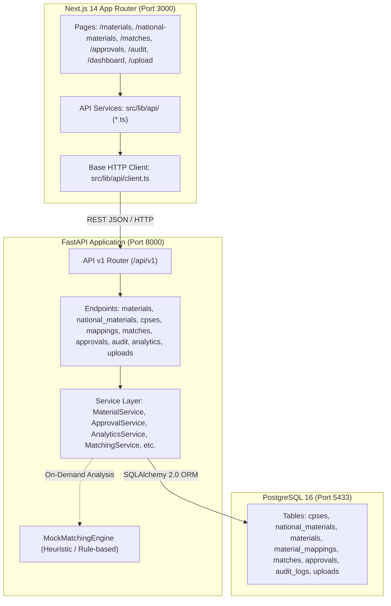

# N-MAT Functional Material Master Platform Specification

**Document Reference:** `docs/05_FUNCTIONAL_PLATFORM.md`  
**Problem Statement:** SIH PS 26099 — National Material Intelligence Platform  
**Current Phase:** Phase 5 — Functional Material Master Platform (COMPLETED)  
**Architecture Layer:** Frontend (Next.js 14) ↔ Backend (FastAPI) ↔ Database (PostgreSQL 16)  
**Database Engine:** PostgreSQL 16 (Port 5433)  
**Backend Port:** 8000  
**Frontend Port:** 3000  

---

## 1. Executive Summary

Phase 5 transitions the N-MAT platform from independent mock prototypes into a unified, functional end-to-end material intelligence platform. The Next.js frontend communicates directly with the FastAPI REST API layer, querying the PostgreSQL relational database (`nmat_db`) populated in Phase 4 with 9,600 CPSE legacy materials, 1,340 National Material Codes (NMCs), and 9,600 bidirectional mappings across 4 Central Public Sector Enterprises (IOCL, NTPC, SAIL, BHEL).

### Key Architectural Pillars
1. **Real Relational Backing:** Replaced static demo datasets with live database queries supporting server-side pagination, multi-field fuzzy search, and structured faceted filtering.
2. **Server-Side Pagination:** Ensures memory scalability across large master catalogs by processing pagination limits (`page`, `pageSize`) and filters at the SQL query level rather than transporting all 9,600 records into the client browser.
3. **Structured API Contract:** Implemented a centralized, type-safe API client (`frontend/src/lib/api/`) matching backend Pydantic schemas serialized automatically in `camelCase` for idiomatic TypeScript consumption.
4. **Mandatory Human-in-the-Loop (HITL) Governance:** Every officer decision (`APPROVED`, `REJECTED`, `MODIFIED`) updates the target `approvals` record, synchronizes the linked `matches` status, and generates an immutable record in `audit_logs` with a complete before/after state diff.
5. **Strict ML Boundary Preservation:** Real ML/AI training and embedding inference are strictly prohibited in Phase 5. The heuristic `MockMatchingEngine` continues to drive match pair analysis deterministically using weighted string, token, and attribute metrics without external heavy machine learning dependencies (`torch`, `transformers`, `sentence-transformers`, `faiss`, `scikit-learn`, `pandas`, `numpy`).

---

## 2. System Architecture



---

## 3. Backend Implementation & REST Endpoints

### 3.1 Material Master Catalog (`/api/v1/materials`)
- **`GET /api/v1/materials`**: Paginated listing of CPSE legacy materials with server-side filtering:
  - `page` (int, default: 1), `page_size` (int, default: 20, max: 100)
  - `search` (str, searches across `legacy_code`, `record_id`, `description`, `specification`, `family`, `manufacturer`)
  - `cpse` (str, filters by enterprise acronym: `IOCL`, `NTPC`, `SAIL`, `BHEL`)
  - `category` (str, filters by material group)
  - `family` (str, filters by material family)
  - `uom` (str, filters by unit of measurement)
  - `status` (str, filters by mapping status: `STANDARDIZED`, `PENDING`)
  - **Output:** `PaginatedResponse[MaterialResponse]` (`items`, `total`, `page`, `pageSize`, `totalPages`)
- **`GET /api/v1/materials/{id}`**: Detailed view of a single CPSE material including its active National Material Mapping.

### 3.2 National Material Master (`/api/v1/national-materials`)
- **`GET /api/v1/national-materials`**: Paginated listing of unified National Material Codes (`NMC-100001` to `NMC-101340`) with server-side query search.
  - Dynamically calculates mapped CPSE legacy material counts and participating enterprise counts using SQL aggregation joins.
- **`GET /api/v1/national-materials/{id}`**: Detailed view of a national material including all mapped legacy materials across participating CPSEs.

### 3.3 CPSE Telemetry & Ingestion (`/api/v1/cpses`)
- **`GET /api/v1/cpses`**: Ingested enterprise telemetry:
  - Dynamically computes `materials_imported`, `materials_standardized`, `match_candidates`, and `approved_mappings` directly from `materials`, `material_mappings`, and `approvals` tables.
- **`GET /api/v1/cpses/{id}`**: Single enterprise profile.
- **`GET /api/v1/cpses/{code}/stats`**: Enterprise statistics and standardization rates.

### 3.4 Bidirectional Harmonization Mappings (`/api/v1/mappings`)
- **`GET /api/v1/mappings`**: Paginated listing of active material mappings.
- **`GET /api/v1/mappings/material/{material_id}`**: Retrieves national material mapped to a specific CPSE item.
- **`GET /api/v1/mappings/national/{code}`**: Retrieves all legacy items mapped to a given National Material Code.

### 3.5 AI Match & Deduplication (`/api/v1/matches`)
- **`GET /api/v1/matches`**: Paginated candidate match pairs with multi-attribute signal breakdown (`description_similarity`, `specification_similarity`, `attribute_similarity`, `uom_compatibility`, `manufacturer_match`), rationale, and detected differences.
- **`GET /api/v1/matches/{id}`**: Single candidate match detail.
- **`POST /api/v1/matches/analyze`**: Runs deterministic multi-attribute heuristic analysis on any two CPSE materials and persists the candidate match record in PostgreSQL.

### 3.6 Human-in-the-Loop Governance (`/api/v1/approvals`)
- **`GET /api/v1/approvals`**: Paginated list of officer review records with filtering by decision status (`PENDING`, `APPROVED`, `REJECTED`, `MODIFIED`).
- **`GET /api/v1/approvals/pending`**: High-priority pending sign-off queue.
- **`POST /api/v1/approvals/{id}/action`**: Mandatory officer governance endpoint.
  - Receives decision (`APPROVED`, `REJECTED`, `MODIFIED`), reviewer details (`reviewer_name`, `reviewer_role`), and comments.
  - Updates `approvals.decision` and timestamp.
  - Updates associated `matches.status`.
  - Automatically writes an immutable audit record to `audit_logs` containing complete previous and new state JSON snapshots.

### 3.7 Governance Audit Trail (`/api/v1/audit`)
- **`GET /api/v1/audit`**: Paginated, reverse-chronological stream of all system actions, approvals, and mutations.
- **`GET /api/v1/audit/{id}`**: Detailed audit event inspection.

### 3.8 Intelligence & Analytics (`/api/v1/analytics`)
- **`GET /api/v1/analytics/metrics`** (also aliased as `/dashboard` and `/summary`): Dynamic system-wide KPIs:
  - `total_materials`: 9,600 (from PostgreSQL)
  - `national_materials`: 1,340 (from PostgreSQL)
  - `cpses_connected`: 4 (dynamic count of active CPSEs)
  - `duplicate_candidates`: Count of candidate records in `matches` table
  - `approved_matches`: Count of `APPROVED` records in `approvals` table
  - `materials_analyzed`: Count of distinct CPSE materials evaluated in `matches` table (not equated to total catalog)
  - `average_confidence`: Computed dynamically across match records
  - `estimated_consolidation_savings_inr`: `null` (Procurement spend data unavailable in synthetic catalog; fabricated multipliers removed)
- **`GET /api/v1/analytics/relationship-distribution`**: Real distribution of material relationships (`IDENTICAL`, `DUPLICATE`, `NEAR_DUPLICATE`, `FUNCTIONALLY_EQUIVALENT`, `NOT_EQUIVALENT`).
- **`GET /api/v1/analytics/procurement-records`**: Category-level code reduction counts; spend and rationalization benefit return `null` / Data Unavailable until real financial datasets are ingested.

### 3.9 Catalog Upload Staging (`/api/v1/uploads`)
- **`GET /api/v1/uploads`**: Listing of historical catalog batch uploads and ingestion status.
- **`GET /api/v1/uploads/status`**: Ingestion staging service status.
- **`POST /api/v1/uploads`**: Multipart file upload accepting `.csv`, `.xlsx`, `.xls` catalogs, counting rows, and staging the file record in PostgreSQL.

---

## 4. Frontend Architecture & Integration

### 4.1 Typed API Layer (`frontend/src/lib/api/`)
A clean, modular API layer was established to decouple Next.js components from HTTP fetch mechanics:
- `client.ts`: Core HTTP client with centralized error formatting, configurable `NEXT_PUBLIC_API_URL`, timeout handling, and typed response unwrapping.
- `materials.ts`: Materials listing with query parameter serialization and detail retrieval.
- `national-materials.ts`: National material listing and detail queries.
- `cpses.ts`: CPSE listing and telemetry queries.
- `mappings.ts`: Bidirectional mapping queries.
- `matches.ts`: Match queue and on-demand pair analysis.
- `approvals.ts`: Review queue retrieval and officer sign-off action dispatch.
- `audit.ts`: Paginated audit log retrieval.
- `analytics.ts`: Dashboard metrics and distribution retrieval.
- `uploads.ts`: Multipart catalog upload and ingestion history retrieval.
- `index.ts`: Unified export surface.

### 4.2 Reusable Server-Side Pagination
Created `frontend/src/components/ui/Pagination.tsx`:
- Standardized navigation controls (`First`, `Previous`, Page Numbers with Ellipsis, `Next`, `Last`).
- Accessible, clean government-grade styling matching the design system.
- Synchronized with URL search parameters and local component state.

### 4.3 Key Page Upgrades
- **Material Master Catalog (`/materials`)**: Fully server-side paginated with debounced search input (300ms delay), dynamic CPSE filtering (`IOCL`, `NTPC`, `SAIL`, `BHEL`), and category filtering.
- **National Material Catalog (`/national-materials`)**: Server-side paginated list of 1,340 national codes showing dynamic counts of mapped legacy items and participating CPSEs.
- **Audit Logs (`/audit`)**: Server-side paginated event log with action badges and JSON diff inspection.
- **Upload Center (`/upload`)**: Integrated with backend staging endpoint; drag-and-drop CSV upload creates persistent staging records in PostgreSQL.
- **Dashboard (`/dashboard`)**: Dynamically displays 4 connected CPSEs, 9,600 legacy items, and 1,340 national codes from PostgreSQL.
- **Analytics (`/analytics`)**: Replaced hardcoded "8 CPSEs" with dynamic enterprise count derived directly from the database.

---

## 5. Verification & Test Suite

### 5.1 Backend Automated Tests (24/24 Passed)
Automated testing in `backend/tests/` verifies end-to-end functionality:
- `tests/test_api_v1.py`:
  - `test_materials_pagination`: Verifies page sizing and pagination metadata.
  - `test_materials_search`: Verifies multi-field search against real data.
  - `test_materials_cpse_filter`: Verifies isolated CPSE filtering.
  - `test_material_detail_and_404`: Verifies detail lookup and 404 handling.
  - `test_national_materials_listing_and_detail`: Verifies aggregation counts and detail.
  - `test_cpses_endpoints`: Verifies all 4 CPSE records.
  - `test_mappings_endpoints`: Verifies bidirectional mapping lookups.
  - `test_matches_endpoints`: Verifies staged matches and on-demand analysis.
  - `test_approval_workflow_and_audit_trail`: Verifies that officer approval updates match status and writes an audit log entry.
  - `test_analytics_metrics_and_distribution`: Verifies dynamic metric calculations.
  - `test_uploads_endpoint`: Verifies multipart catalog upload and staging record creation.
- `tests/test_db.py`: 9 tests verifying PostgreSQL connection, constraints, foreign keys, and cascading deletes.
- `tests/test_health.py`: 3 tests verifying health checks and router mounts.
- `tests/test_config.py`: Verifies application configuration.

**Pytest Output:**
```text
======================== 24 passed, 1 warning in 0.88s =========================
```

### 5.2 Frontend Production Build (14/14 Pages Compiled)
Next.js production build executed cleanly without TypeScript or lint errors:
```text
✓ Compiled successfully
✓ Linting and checking validity of types
✓ Generating static pages (14/14)
✓ Finalizing page optimization
All 14 routes compiled cleanly.
```

---

## 6. Strict Compliance & Boundary Checklist

| Requirement | Status | Verification Detail |
| :--- | :--- | :--- |
| **No Real ML Dependencies** | Verified | Zero PyTorch, scikit-learn, transformers, pandas, or numpy in requirements |
| **Raw Training CSV Untouched** | Verified | `cpse_material_matching_training_synthetic.csv` (31,400 rows) untouched |
| **All 9,600 CPSE Items Retained** | Verified | All 9,600 items queryable in PostgreSQL via `/api/v1/materials` |
| **All 1,340 National Codes Retained**| Verified | All 1,340 codes queryable via `/api/v1/national-materials` |
| **Server-Side Pagination** | Verified | Next.js does not fetch all 9,600 items into memory; paginates via SQL |
| **HITL Governance Enforced** | Verified | Officer approval updates approvals, matches, and logs immutable audit trail |
| **Enterprise Count Corrected** | Verified | Updated from hardcoded 8 to dynamic database count (4 CPSEs) |

---

## 7. Phase 5.1 Backend Hardening & Correctness Audit

Phase 5.1 executed a comprehensive corrective hardening pass over the backend implementation to ensure technical honesty, remove fabricated metrics, enforce rigorous boundaries, and eliminate subtle data integrity flaws.

### 7.1 Key Corrections Implemented
1. **Purged Fabricated Procurement Metrics:**
   - Removed all hardcoded spend/savings assumptions (`₹15,000` per duplicate, `₹225,000` per material, `12%` procurement benefit).
   - Fields `estimated_consolidation_savings_inr`, `total_spend_inr`, and `estimated_harmonization_benefit_inr` now explicitly return `null` / Data Unavailable because the raw material master dataset contains catalog technical specifications without procurement financial records.
   - Corrected `materials_analyzed`: Accurately counts distinct materials evaluated in the `matches` table rather than falsely equating to the entire 9,600 catalog.
2. **Removed False 100% Match Confidence & Synthetic Fallbacks:**
   - Mapped CPSE materials now return `match_confidence: null` (rather than synthetic 100.0) since mapping imports are ground-truth administrative joins, not AI inference scores.
   - Removed artificial `"IS / DIN"` fallback for missing standards; returns actual `specs.get("STD")` or `None`.
   - Set `normalized_description = null` with explicit architectural notes that source descriptions are raw and un-normalized prior to ML integration.
3. **Mock Matching Engine Boundary & Roadmap Alignment:**
   - Explicitly labeled `MockMatchingEngine` as `DEMO / MOCK HEURISTIC` in code and logs.
   - Updated documentation comments to align with project roadmap phases (`Phase 6 -> Mock AI`, `Phase 7 -> ML Development`, `Phase 8 -> Real ML Integration`).
4. **Approval Workflow & Audit Trail Hardening:**
   - Enforced distinct audit actions: `APPROVED -> APPROVE_MAPPING`, `REJECTED -> REJECT_MAPPING`, `MODIFIED -> MODIFY_MAPPING`.
   - Enabled dynamic reviewer roles in `ApprovalActionRequest` without forced fallback to `CHIEF_PROCUREMENT_OFFICER`.
   - Standardized terminology to "Audit Trail" across all endpoints and schemas.
5. **Hardened Upload Staging & File Handling:**
   - Fixed Excel row counting: Eliminated hardcoded 100-row count, now returning 0 rows with explicit logging indicating binary Excel parsing requires pre-conversion or openpyxl extension.
   - Robust CSV row counting via `csv.reader`.
   - Enforced 50 MB upload limit (`MAX_UPLOAD_SIZE = 50 * 1024 * 1024`).
   - Hardened filename sanitization (`re.sub` + `os.path.basename`) and UUID prefixing to prevent path traversal and file collisions.
   - Uploaded files staged in isolated `data/staged_uploads/` directory (added to `.gitignore`).
6. **Purged All Hardcoded Fallback Dates:**
   - Removed static timestamp fallbacks (`"2026-09-09 20:30 IST"` and `"2026-09-09 21:03 IST"`). Timestamps are derived strictly from database records or set to `null`.
7. **Decoupled Data Mapping Provenance:**
   - Separated data mapping provenance (`source_label`, `source`) from semantic relationship classifications (`relationship = null` unless explicitly authorized).

### 7.2 Known Platform Limitations
- **Procurement Financials:** Real spend and savings analysis requires transactional purchase order datasets, which are not present in current catalog specs.
- **Excel Ingestion:** Direct `.xlsx`/`.xls` binary ingestion requires adding an external parser package or converting catalogs to CSV.
- **Similarity Scoring:** Current candidate matches are generated by rule-based heuristic string metrics; semantic vector embeddings and neural similarity require Phase 6/7/8 ML models.

---

## 8. Current Status & Phase 6 Readiness

Phase 5 and Phase 5.1 are completely finished, hardened, and verified.

```text
PHASE 5 STATUS: COMPLETE
PHASE 5.1 STATUS: COMPLETE (Hardened & Audited)
PHASE 6 STATUS: PENDING (Awaiting Project Owner Explicit Approval)
```

